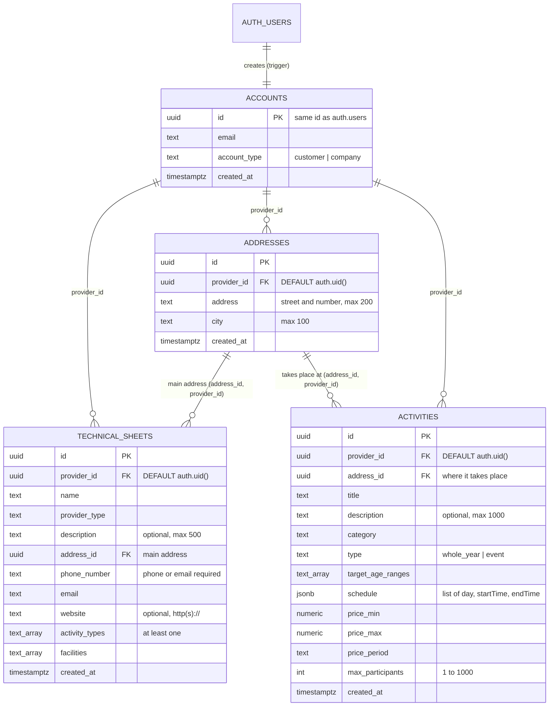
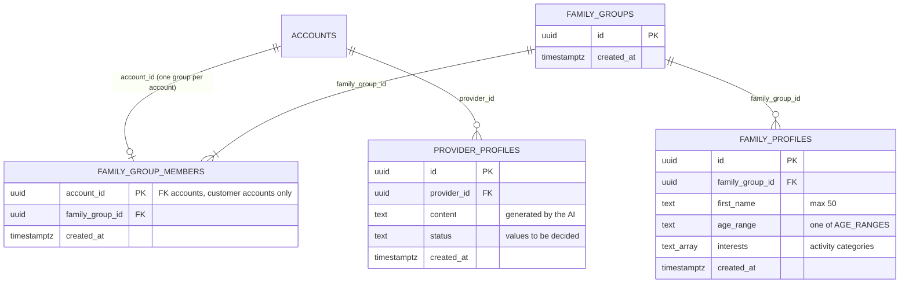

# Decision 002: Database design

## Status

Accepted for the tables that exist today (`accounts`, `technical_sheets`, `addresses`, `activities`).
**Proposed** for the tables that other issues will create (`family_groups`, `family_group_members`, `family_profiles`, `provider_profiles`): the team member who implements each one may change the details, but must update this document in the same pull request.

## Context

AfterBell stores data of three kinds of people with very different privacy needs:

- **Providers** (clubs, schools, academies, tutors) publish activities that every family must be able to find.
- **Families** describe their children (minors) to receive recommendations. Nobody outside the family may see that data.
- **The AI** reads each provider's technical sheet and writes a public profile.

The app talks to Supabase directly with the **publishable key**, which anyone can extract from the app. Therefore the database, not the app, has to enforce who can read and change each row. The app validation only improves the user experience.

The database is changed by four people in parallel, in different branches, during short sprints. The design has to be easy to understand, easy to extend with new migrations and hard to break by mistake.

## Schema

### Current tables

### Planned tables (other issues)

The whole schema, with every table, is also in [`database.dbml`](database.dbml): paste it in [dbdiagram.io](https://dbdiagram.io) to see and move the diagram, and export it as an image or PDF. Keep it in sync with these diagrams.

The source of truth is always the migrations in `supabase/migrations/`. To see the real schema of your local database, open Studio (`http://127.0.0.1:54323`) → *Database → Schema Visualizer*. Update the diagrams above in the same pull request as any migration that changes a table.

## Decisions

### General rules

| Decision | Alternatives considered | Why |
|---|---|---|
| **UUID primary keys** (`gen_random_uuid()`) | Integer ids (as drawn in the first diagram, because the drawing tool had no UUID type) | Supabase user ids are UUIDs and every RLS policy compares rows with `auth.uid()`. UUIDs can also be created without asking the database for the next number and do not reveal how many rows exist. |
| **`accounts` table with the same id as `auth.users`**, created by a trigger | Reading `auth.users` directly / creating the account from the app | The `auth` schema belongs to Supabase and is not exposed to the app. The trigger guarantees that every user has exactly one account, even if the app fails after sign-up. |
| **`account_type` (`customer` or `company`)** and the function `is_company()` | One table per account type | Most rules only need to know "is this user a provider?". `is_company()` is reused by every policy that is limited to providers. |
| **Owner columns default to the logged-in user** (`provider_id DEFAULT auth.uid()`) | The app sends the owner id | The app cannot send a wrong or forged owner; RLS checks it anyway. It is one field less in every insert. |
| **Two security layers in every table:** column privileges (`GRANT`) and Row-Level Security | RLS only | RLS decides **which rows** a user can touch, but not **which columns**. Without column privileges an owner could change `provider_id` (give the row to someone else), `id`, `type` or `created_at`. Each table starts with `REVOKE ALL` and grants only what the app needs. |
| **Start closed** (no policy = no access) | Open first and close later | Opening access later is a new policy. Closing it after a release means the data has already been exposed. |
| **`CHECK` constraints mirror the app validation**, including length limits | Validation only in the app | The publishable key lets anyone skip the app. The limits also cap the text that is sent to the LLM (cost and prompt injection). |
| **Value lists as `TEXT` + `CHECK`** (provider types, categories, ages, facilities, price periods) | PostgreSQL `ENUM` types / lookup tables | Adding a value is a simple migration that replaces the constraint (as done for `outdoor_field` and `indoor_court`); an `ENUM` cannot easily remove or rename values. A lookup table would add joins for lists that only change with the code, since the app needs the labels and the type anyway (`as const` lists in `src/lib/`). The values in the `CHECK` are exactly the values of the app lists. |
| **Optional text is `NULL`**, never `''` | Empty strings | One way of saying "no value" keeps queries and `CHECK` constraints simple (`email IS NOT NULL`). |
| **Money is `NUMERIC(8, 2)`** with a price period | `FLOAT` / integer cents without a period | `FLOAT` cannot store 0.10 exactly. A price without a period ("40" per month or per year?) is ambiguous. |
| **No `updated_at` columns yet** | Adding them to every table | Nothing in the app reads them, and keeping them right needs a trigger per table. They will be added with a migration when a feature needs them (e.g. "profile out of date"). |
| **Permanent deletes** where deleting is allowed | Soft delete (`deleted_at`) | Simpler for the course project. Every query would otherwise have to filter deleted rows. |
| **An index on every foreign key used by policies or joins**, no other indexes | Indexing "just in case" | Policies filter by `provider_id` on every query. Other indexes are added when a real query needs them. |

### Providers: technical sheet, addresses and activities

| Decision | Alternatives considered | Why |
|---|---|---|
| **Technical sheets are private to their owner** | Readable by families | Families see the public profile generated by the AI, not the raw sheet. Opening the sheet later is one new policy. |
| **Ages, schedule and prices belong to each activity**, not to the sheet | Keeping them in both tables | A provider offers activities with different ages, times and prices. Keeping them in two places would duplicate data. |
| **`addresses` is its own table**, with `address` (street and number in one text) and `city` | Address and city as columns of the sheet / street, number and postcode in separate columns | A provider can teach in several places (a main venue and a sports centre), and each activity takes place in one of them. One text for the street is enough for families to find the place; `city` is a separate column because activities will be searched by city. |
| **Addresses are entered in the technical sheet form**, and the first one is the sheet's main address (`technical_sheets.address_id`) | Asking for them at sign-up / a separate addresses screen | The sheet is where the provider describes itself; the sign-up stays short. Using the first address as the main one avoids an extra "main" field. |
| **Composite foreign keys** `(address_id, provider_id) → addresses (id, provider_id)` | A simple foreign key `address_id → addresses (id)` plus a check in the app | With a simple key, a provider could attach its activity to another provider's address (addresses are readable by every logged-in user). The composite key makes the database reject it. It needs `UNIQUE (id, provider_id)` in `addresses`. |
| **An address in use cannot be deleted** (`ON DELETE NO ACTION`) | `ON DELETE CASCADE` / `SET NULL` | Deleting an address must never delete activities or leave them without a place. `NO ACTION` is checked at the end of the statement, so deleting an account still removes its sheets, activities and addresses together. |
| **Addresses are readable by every logged-in user** | Owner only | Families need to know where an activity takes place. Only the owner can create, change or delete them. |
| **The sheet and its addresses are saved in several requests**, and the new addresses are deleted if a later step fails | One database function (`rpc`) that saves everything in a transaction | Simpler to write and test for now. If more multi-table saves appear, move them to a `SECURITY INVOKER` function so that they are atomic. |
| **Any logged-in user can read activities**; only the owner can change or delete them | Owner only / public without login | Families must find activities to sign up. Users without a session (`anon`) cannot read them. |
| **Schedule as a `JSONB` list**, validated by `is_valid_schedule()` | A `time_slots` table | One insert saves the whole activity and the shape matches the app type `TimeSlot`. The function checks each slot (day, `HH:MM`, start before end), because a `CHECK` cannot loop over a list. |
| **`type` (`whole_year` or `event`) is fixed after creation** | Editable | Changing the type changes what the activity is. Events and their dates arrive in a later sprint. |
| **The number of enrolled people is not stored** | An `enrolled_count` column | Enrollments do not exist yet, and a stored counter can drift from reality. It will be computed from the enrollments table. |
| **Activities point to the provider (`provider_id`), not to its profile** | `provider_profile_id` in activities | The profile is generated text that can be regenerated or replaced; the provider is the stable owner of the activity. |

### Families (proposed)

| Decision | Alternatives considered | Why |
|---|---|---|
| **`family_groups` + `family_group_members`** | Children linked directly to one account | Two parents (two accounts) must share the same children and see the same recommendations. |
| **One account belongs to one family group** (`account_id` is the primary key of `family_group_members`) | Several groups per account | Team decision: it keeps "my family" unambiguous in every screen and policy. |
| **Only `customer` accounts can be members** | Any account | Providers do not have families in the app. Checked in the trigger and in the policies (`NOT is_company()`). |
| **A group is created automatically for every new customer account** (a new trigger on `accounts`) | The app creates it after sign-up | Every family screen can assume the group exists. Joining another parent's group (invitations) is a later feature. |
| **`family_profiles` store a first name, an age range and interests** | Full name / birth date | The children are minors: store the minimum. An age range is enough for recommendations; a birth date would be personal data with no use. Interests use the activity categories list. |
| **Family data is visible only to the members of the group** | Visible to providers | Nobody else needs it. When a family signs up for an activity, the enrollment will store what the provider needs. |
| **Membership checks use a `SECURITY DEFINER` helper** (e.g. `is_family_member(group_id)`) | A subquery on `family_group_members` inside its own policy | A policy on `family_group_members` that reads `family_group_members` calls itself and fails with *infinite recursion*. The helper reads the table without RLS and returns only `true` or `false`. |

### AI profiles (proposed)

| Decision | Alternatives considered | Why |
|---|---|---|
| **`provider_profiles` is written only by an Edge Function** with the secret key | Written by the app | The LLM key and the generation logic must not live in the app. The secret key bypasses RLS, so no `INSERT`/`UPDATE` policy is needed for `authenticated`. |
| **Status values and uniqueness are still to be decided** by the team member who builds it | — | For example `draft`/`published`, and at most one published profile per provider with a partial unique index: `CREATE UNIQUE INDEX ... ON provider_profiles (provider_id) WHERE status = 'published'`. |
| **Families read only published profiles; the owner reads its own** | Public | Same principle as the other tables: start closed. |

## Consequences

- Every schema change is a new migration. Migrations already in `main` are never edited (see *Database* in `mobile/AGENTS.md`).
- After every migration, regenerate `mobile/src/lib/database.types.ts`; `tsc` then lists every place in the app that must change.
- New tables follow the same template: UUID id, owner column with a default, `CHECK` constraints, `REVOKE ALL` + `GRANT`, RLS policies, index on the owner column, and SQL tests impersonating at least two owners and one other account.
- A provider can still have **several technical sheets**. If the team decides that there is only one, add `UNIQUE (provider_id)` with a new migration.
- Saving a sheet with its addresses is not atomic (see above).
- Dates of events, enrollments and the AI profile will add tables; this document and its diagrams are updated with them.
