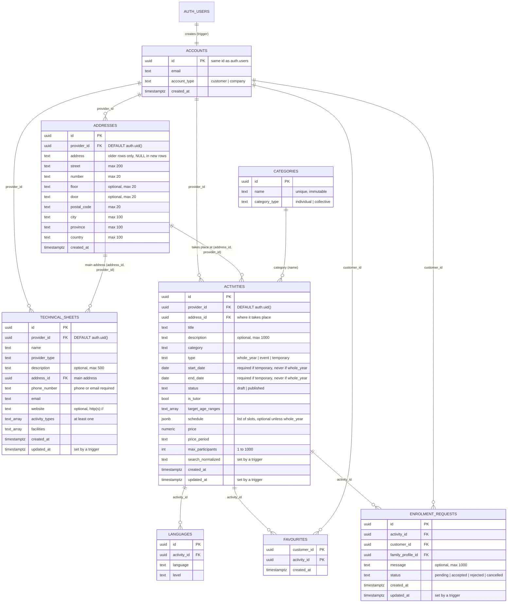
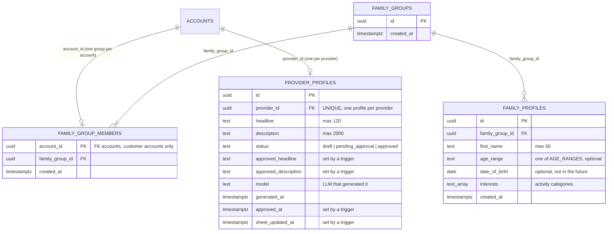

# Decision 002: Database design

## Status

Accepted. Every table in this document is implemented: `accounts`, `technical_sheets`, `addresses`, `activities`, `categories`, `languages`, `favourites`, `enrolment_requests`, `family_groups`, `family_group_members`, `family_profiles`, `provider_profiles`, `search_summary_cache` and `search_summary_requests`.

New tables (events, enrollments, favourites…) are added to this document, its diagrams and `database.dbml` in the same pull request as their migration.

## Context

AfterBell stores data of three kinds of people with very different privacy needs:

- **Providers** (clubs, schools, academies, tutors) publish activities that every family must be able to find.
- **Families** describe their children (minors) to receive recommendations. Nobody outside the family may see that data.
- **The AI** reads each provider's technical sheet and writes a public profile.

The app talks to Supabase directly with the **publishable key**, which anyone can extract from the app. Therefore the database, not the app, has to enforce who can read and change each row. The app validation only improves the user experience.

The database is changed by four people in parallel, in different branches, during short sprints. The design has to be easy to understand, easy to extend with new migrations and hard to break by mistake.

## Schema

### Current tables

### Families and AI profiles

The whole schema, with every table, is also in [`database.dbml`](database.dbml): paste it in [dbdiagram.io](https://dbdiagram.io) to see and move the diagram, and export it as an image or PDF. Keep it in sync with these diagrams.

The source of truth is always the migrations in `supabase/migrations/`. To see the real schema of your local database, open Studio (`http://127.0.0.1:54323`) → *Database → Schema Visualizer*. Update the diagrams above in the same pull request as any migration that changes a table.

## Decisions

### General rules

| Decision | Alternatives considered | Why |
|---|---|---|
| **UUID primary keys** (`gen_random_uuid()`) | Integer ids (as drawn in the first diagram, because the drawing tool had no UUID type) | Supabase user ids are UUIDs and every RLS policy compares rows with `auth.uid()`. UUIDs can also be created without asking the database for the next number and do not reveal how many rows exist. |
| **`accounts` table with the same id as `auth.users`**, created by a trigger | Reading `auth.users` directly / creating the account from the app | The `auth` schema belongs to Supabase and is not exposed to the app. The trigger guarantees that every user has exactly one account, even if the app fails after sign-up. |
| **`account_type` (`customer` or `company`)** and the function `is_company()` | One table per account type | Most rules only need to know "is this user a provider?". `is_company()` is reused by every policy that is limited to providers. |
| **Owner columns default to the logged-in user** (`provider_id DEFAULT auth.uid()`) | The app sends the owner id | The app cannot send a wrong or forged owner; RLS checks it anyway. It is one field less in every insert. |
| **Two security layers in every table:** column privileges (`GRANT`) and Row-Level Security | RLS only | RLS decides **which rows** a user can touch, but not **which columns**. Without column privileges an owner could change `provider_id` (give the row to someone else), `id`, `type` or `created_at`. Each table starts with `REVOKE ALL` and grants only what the app needs. |
| **Start closed** (no policy = no access) | Open first and close later | Opening access later is a new policy. Closing it after a release means the data has already been exposed. |
| **`CHECK` constraints mirror the app validation**, including length limits | Validation only in the app | The publishable key lets anyone skip the app. The limits also cap the text that is sent to the LLM (cost and prompt injection). |
| **Value lists as `TEXT` + `CHECK`** (provider types, ages, facilities, price periods) | PostgreSQL `ENUM` types / lookup tables | Adding a value is a simple migration that replaces the constraint (as done for `outdoor_field` and `indoor_court`); an `ENUM` cannot easily remove or rename values. The values in the `CHECK` are exactly the values of the app lists. Categories are the exception: since C11 they live in the `categories` table. |
| **Optional text is `NULL`**, never `''` | Empty strings | One way of saying "no value" keeps queries and `CHECK` constraints simple (`email IS NOT NULL`). |
| **Money is `NUMERIC(8, 2)`** with a price period | `FLOAT` / integer cents without a period | `FLOAT` cannot store 0.10 exactly. A price without a period ("40" per month or per year?) is ambiguous. |
| **`updated_at` only where a feature needs it** (`activities`, `technical_sheets`, `enrolment_requests`) | Adding it to every table | Keeping it right needs a trigger per table. The technical sheet needs it to detect an out-of-date profile. |
| **Permanent deletes** where deleting is allowed | Soft delete (`deleted_at`) | Simpler for the course project. Every query would otherwise have to filter deleted rows. |
| **An index on every foreign key used by policies or joins**, no other indexes | Indexing "just in case" | Policies filter by `provider_id` on every query. Other indexes are added when a real query needs them. |

### Providers: technical sheet, addresses and activities

| Decision | Alternatives considered | Why |
|---|---|---|
| **Technical sheets are private to their owner**; customers get the contact details from `public_provider_contacts()` | Readable by families | Families see the public profile generated by the AI, not the raw sheet. The function returns only the name and contact details of providers with a published activity. |
| **Ages, schedule and prices belong to each activity**, not to the sheet | Keeping them in both tables | A provider offers activities with different ages, times and prices. Keeping them in two places would duplicate data. |
| **`addresses` is its own table**, with structured fields (street, number, floor, door, postal code, city, province, country) | Address and city as columns of the sheet / street and number in one text (Sprint 1) | A provider can teach in several places (a main venue and a sports centre), and each activity takes place in one of them. C11 structured the fields; `address` remains only for older rows, and the app shows it when it exists. |
| **Addresses are entered in the technical sheet form**, and the first one is the sheet's main address (`technical_sheets.address_id`) | Asking for them at sign-up / a separate addresses screen | The sheet is where the provider describes itself; the sign-up stays short. Using the first address as the main one avoids an extra "main" field. |
| **Composite foreign keys** `(address_id, provider_id) → addresses (id, provider_id)` | A simple foreign key `address_id → addresses (id)` plus a check in the app | With a simple key, a provider could attach its activity to another provider's address (addresses are readable by every logged-in user). The composite key makes the database reject it. It needs `UNIQUE (id, provider_id)` in `addresses`. |
| **An address in use cannot be deleted** (`ON DELETE NO ACTION`) | `ON DELETE CASCADE` / `SET NULL` | Deleting an address must never delete activities or leave them without a place. `NO ACTION` is checked at the end of the statement, so deleting an account still removes its sheets, activities and addresses together. |
| **Addresses are readable by every logged-in user** | Owner only | Families need to know where an activity takes place. Only the owner can create, change or delete them. |
| **The sheet and its addresses are saved in several requests**, and the new addresses are deleted if a later step fails | One database function (`rpc`) that saves everything in a transaction | Simpler to write and test for now. If more multi-table saves appear, move them to a `SECURITY INVOKER` function so that they are atomic. |
| **Logged-in users read published activities; the owner also reads its drafts** and only the owner can change or delete them | Owner only / every activity public | Families must find activities, but not work in progress. Users without a session (`anon`) cannot read them. Publishing needs a complete technical sheet and a structured address, checked by `require_publication_fields`. |
| **Schedule as a `JSONB` list**, validated by `is_valid_schedule()` | A `time_slots` table | One insert saves the whole activity and the shape matches the app type `TimeSlot`. The function checks each slot (day, `HH:MM`, start before end), because a `CHECK` cannot loop over a list. |
| **One price with its period** (`price`, `price_period`) | A price range (`price_min`, `price_max`), used in Sprint 1 | Providers publish one price per activity; the range made the form and the catalog harder to read. Existing activities kept the lower price of their range. |
| **`type` can be changed by the owner** (`whole_year`, `temporary`; `event` is pending the decision of #91) | Fixed after creation (Sprint 1) | C1 asks providers to switch an activity between whole-year and temporary. The update sends the type and the dates together. |
| **`start_date` and `end_date` are `DATE` columns, required for `temporary` and rejected for `whole_year`** | Storing dates in the schedule / ignoring dates on whole-year activities | They can be sorted and filtered. Rejecting makes a client mistake visible instead of hiding it; the app sends `NULL` when the type becomes whole-year. |
| **The date rules live in the `validate_activity_dates` trigger** | Only `CHECK` constraints | A `CHECK` cannot use `current_date`, and its error only names the constraint. The trigger returns one clear message per case. |
| **A past start date is rejected only when the start date is being set** (on insert, or when `start_date` or `type` changes) | Always | A provider must be able to edit an activity that has already started, for example to extend its end date. |
| **An already published activity is checked for publication again only if a checked field really changes** | Checking on every update | The app sends every field on each save, so activities with an older address could not be edited at all. |
| **The number of enrolled people is not stored** | An `enrolled_count` column | A stored counter can drift from reality. `activity_capacity()` counts the accepted requests in `enrolment_requests`. |
| **Activities point to the provider (`provider_id`), not to its profile** | `provider_profile_id` in activities | The profile is generated text that can be regenerated or replaced; the provider is the stable owner of the activity. |

### Sprint 2 tables (C11)

| Decision | Why |
|---|---|
| **`categories` is a table**, referenced by `activities.category` | Each category has a type (`individual` or `collective`). Names cannot be changed or deleted, because `technical_sheets` and `family_profiles` store them in arrays, checked by a trigger. |
| **`languages` belongs to an activity** | Language and tutor activities need their languages and levels to be published. |
| **`enrolment_requests` can only be changed through functions** (`send_`, `accept_`, `reject_` and `cancel_enrolment_request`) | The functions check who is calling and lock the activity row, so two acceptances cannot go over `max_participants`. |
| **`search_summary_cache` and `search_summary_requests` have no client access** | Only the backend uses them, and they store no search text linked to a person. |

### Families

| Decision | Alternatives considered | Why |
|---|---|---|
| **`family_groups` + `family_group_members`** | Children linked directly to one account | Two parents (two accounts) must share the same children and see the same recommendations. |
| **One account belongs to one family group** (`account_id` is the primary key of `family_group_members`) | Several groups per account | Team decision: it keeps "my family" unambiguous in every screen and policy. |
| **Only `customer` accounts can be members** | Any account | Providers do not have families in the app. Checked in the trigger and in the policies (`NOT is_company()`). |
| **A group is created automatically for every new customer account** (a new trigger on `accounts`) | The app creates it after sign-up | Every family screen can assume the group exists. Joining another parent's group (invitations) is a later feature. |
| **`family_profiles` store a first name, an optional date of birth, an age range and interests** | Full name / age as a number | The children are minors: store the minimum. C11 added `date_of_birth`, agreed with the client, so the age does not go out of date. `age_range` stays until the form uses the date. Interests use the activity categories. |
| **Family data is visible only to the members of the group** | Visible to providers | Nobody else needs it. When a family signs up for an activity, the enrollment will store what the provider needs. |
| **Membership checks use a `SECURITY DEFINER` helper** (`is_family_member(group_id)`) | A subquery on `family_group_members` inside its own policy | A policy on `family_group_members` that reads `family_group_members` calls itself and fails with *infinite recursion*. The helper reads the table without RLS and returns only `true` or `false`. |
| **Protect the first family profile from deletion** | Adding an `is_main` column or allowing every profile to be deleted | The first profile in a family group is considered the main profile, determined by `created_at ASC, id ASC`. The database does not store an `is_main` column. A `BEFORE DELETE` trigger prevents deleting this profile, ensuring that a family with at least one profile cannot become empty through profile deletion. |

### AI profiles

| Decision | Alternatives considered | Why |
|---|---|---|
| **One profile per provider** (`UNIQUE (provider_id)`), saved with an upsert | Keeping every generated version | The app only shows the current profile; regenerating replaces the draft. History can be added later if needed. |
| **`draft` until the provider approves it** (`status`: `draft` or `approved`) | Publishing the generated text directly | Human in the loop: an LLM can make mistakes, so the provider reviews and edits the text before families see it. `approved_at` is set by a trigger, never by the app. |
| **The Edge Function uses the caller's session**, not the secret key | Writing with the secret key (bypasses RLS) | Every query of the function also goes through RLS, so a provider can only generate its own profile. The LLM key stays in the function's secrets and never reaches the app. |
| **Only the owner reads the table; customers use `public_approved_provider_profiles()`** | Approved rows readable in the table | The table also holds the candidate text under review. The function returns only the approved copy. |
| **Contact data is not sent to the LLM** | Sending the whole sheet | The model only needs what describes the provider; personal contact details stay out of the prompt. |

## provider_profiles

AI-generated public profile of a provider (#29). One per provider.

| Column | Type | Notes |
|---|---|---|
| id | uuid | PK |
| provider_id | uuid | UNIQUE, default `auth.uid()`, FK `accounts` ON DELETE CASCADE |
| headline | text | ≤ 120 characters |
| description | text | ≤ 2000 characters |
| status | text | `draft` (default), `pending_approval` or `approved` |
| model | text | LLM model used, ≤ 100 |
| generated_at | timestamptz | Last generation |
| approved_at | timestamptz | Set by the `set_profile_approved_at` trigger |
| approved_headline, approved_description | text | Approved copy, set by the same trigger |
| sheet_updated_at | timestamptz | `updated_at` of the sheet used to generate the text, set by a trigger |

- Constraint `provider_profiles_approved_pair_check`: `approved_headline` and
  `approved_description` are both set or both empty.
- RLS:
  - SELECT: only your own. Customers use `public_approved_provider_profiles()`.
  - INSERT: only the owner, only if it is a company, only as `draft`.
  - UPDATE: only the owner.
  - No DELETE.
- Column grants: only `headline`, `description`, `status`, `model` and
  `generated_at` can be updated, so `provider_id` and `approved_at` cannot be
  changed from the app.

## Consequences

- Every schema change is a new migration. Migrations already in `main` are never edited (see *Database* in `mobile/AGENTS.md`).
- After every migration, regenerate `mobile/src/lib/database.types.ts`; `tsc` then lists every place in the app that must change.
- New tables follow the same template: UUID id, owner column with a default, `CHECK` constraints, `REVOKE ALL` + `GRANT`, RLS policies, index on the owner column, and SQL tests impersonating at least two owners and one other account.
- A provider can still have **several technical sheets**. If the team decides that there is only one, add `UNIQUE (provider_id)` with a new migration.
- Saving a sheet with its addresses is not atomic (see above).
- Older addresses keep `number`, `postal_code` and `province` empty until they are completed. Activities that use them stay published and can be edited, but cannot be published again or moved to another type.
- Events (#91) will add their own table; this document, its diagrams and `database.dbml` are updated with it.
